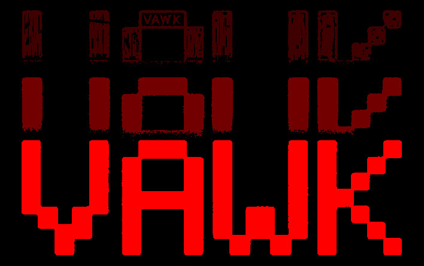
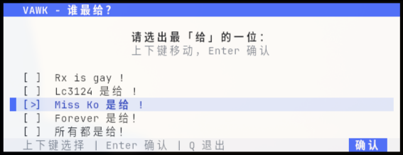
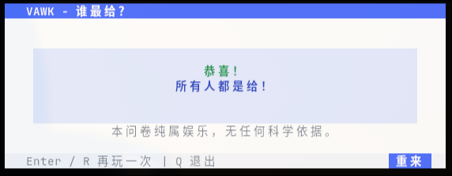

<p align="center">
  <br>
  
  <br>
</p>

<h1 align="center">VAWK</h1>

<p align="center">
  <b>Visual Ansi Widget Kit</b><br>
  <i>静态风味 TUI 框架</i>
</p>


<p align="center">
  
  
  
  
</p>

---

[](https://deepwiki.com/lc-3124/VAWK)

面向 Linux 终端、零外部依赖的 C++23 TUI 框架，自下而上分为 **vaterm**（终端交互）、**vatui**（TUI行为封装）、**vawk**（事件与组件装配系统）三层。

框架倾向基于用低开销、静态的方式来索引对象与处理事件。

> 状态：开发中。

## 截图




## 项目结构

```
VAWK/
├── include/        # 公共头文件（-Iinclude）：vaterm / vatui / vawk(core,widget)
├── src/            # 与 include 镜像的实现
├── demo/           # 每个子目录一个独立演示项目（自带 Makefile）
├── test/           # 用例
├── lib/ build/     # 构建产物
├── contrib/ Makefile CONVENTIONS.md LICENSE README.md logo.jpg
```

## 构建

```
make          # 库 + 全部 demo + 头文件检查（不含测试）
make lib      # lib/libvawk.a 与 libvawk.so
make demo     # 全部演示
make test     # 测试
make check    # 头文件语法检查
make clean
```

---

GPL-3.0 License · 详见 [LICENSE](LICENSE)。
