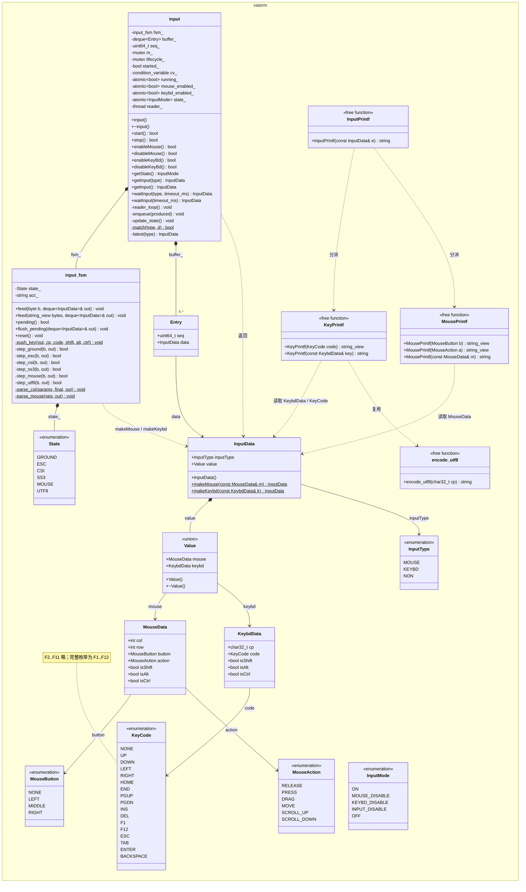

# vaterm/input.hpp — UML 类图

> 对象：`tui-utils/include/vaterm/input.hpp`（`namespace vaterm`）
> 说明：`InputData` 的 `InputType / MouseButton / MouseAction / KeyCode / MouseData / KeybdData / Value` 都是**嵌套在 `InputData` 内部**的子类型，图中为便于排版单独列出。

---

## 一、类图（Mermaid）



---

## 二、数据流

```
                 ┌──────────────────────────── input（模块）────────────────────────────┐
                 │                                                                        │
 stdin(bytes) ──►│  reader_loop()  ──  poll(50ms) / poll(0) 排空  ──►  feed(byte)          │
                 │        ▲                              │                                │
                 │        │ (后台线程 reader_)            ▼                                │
                 │        │                        input_fsm（状态机）                     │
                 │        │                GROUND→ESC→CSI/SS3/MOUSE ；GROUND→UTF8         │
                 │        │                              │                                │
                 │        │                        push_key() / parse_mouse()              │
                 │        │                              ▼                                │
                 │        │                        InputData（键/鼠/空包）                   │
                 │        └──────────────  enqueue() ──► buffer_（环形缓冲, 容量 16）        │
                 │                                             │                           │
                 │             getInput() / waitInput() ◄───────┘                          │
                 └────────────────────────────────────────────────────────────────────────┘
                                │
                                ▼
                     消费者（Entity / 业务）拿 InputData
```

- **生产**：`reader_loop()`（后台线程）→ `input_fsm::feed` → `enqueue()` → `buffer_`
- **消费**：`getInput(type)` 非阻塞取“历史里最新的匹配项”；`waitInput(type,timeout)` 阻塞等“新的匹配项”（`cv_` 通知）
- **取用表（打印）**：`InputPrintf → KeyPrintf / MousePrintf → encode_utf8`

---

## 三、要点

- `InputData::Value` 是 **union**：仅 `inputType` 指定的成员有效（`MOUSE`→`mouse`，`KEYBD`→`keybd`，`NON`→空包）。
- `InputData` 只能通过 `makeMouse / makeKeybd`（或默认构造成空包）产生，避免外部手动组装 union。
- `input_fsm` 是**内部实现**，单独成类只为脱离终端做单元测试；对外只用 `input`。
- `input` 对外接口：`start / stop`、`enableMouse / disableMouse`、`enableKeyBd / disableKeyBd`、`getState`、`getInput / waitInput`；线程安全。
- 环形缓冲容量由宏 `VATERM_INPUT_BUFFER_SIZE`（默认 16）决定，超出丢弃最旧的。
- 循环依赖：`input` 持有 `input_fsm`，`input_fsm` 产出 `InputData`；两者都只依赖 `input.hpp` 内定义。
